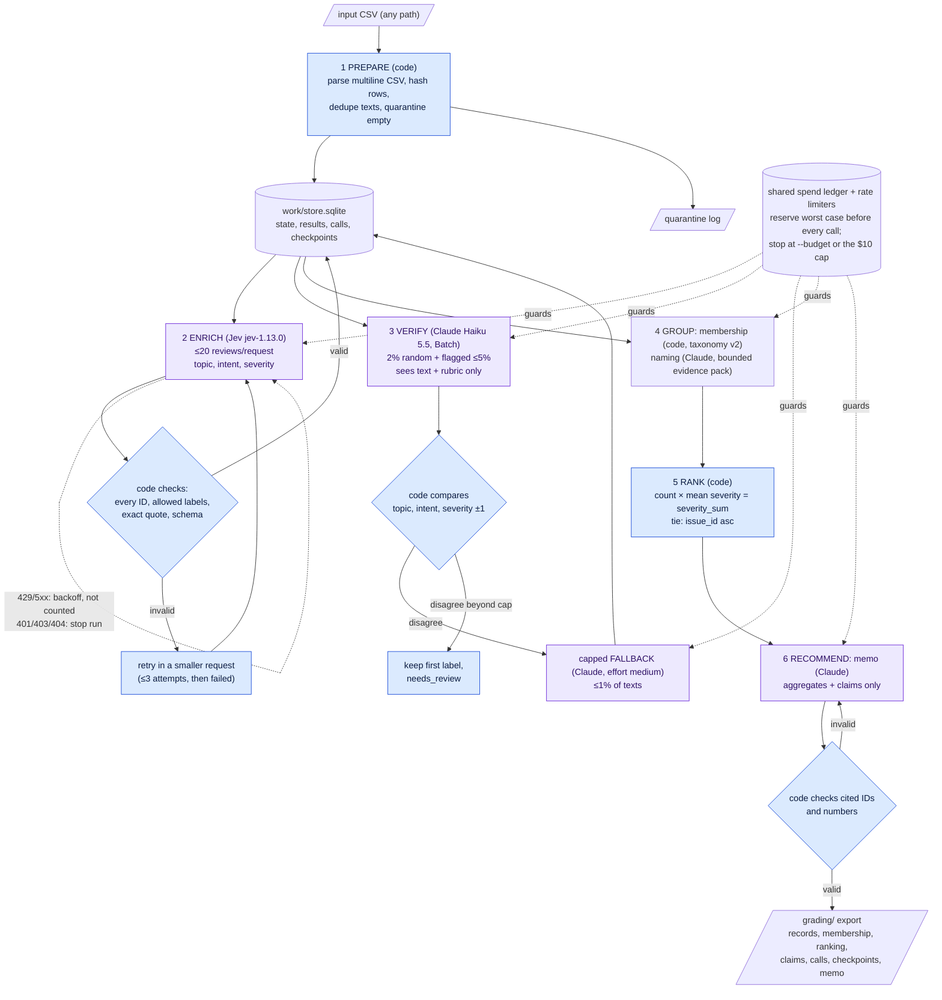

# Spotify Insight Pipeline (Assignment 5)

**Question:** at the end of this review window, where should Spotify's next quarter of product effort go: access, usability, playback or billing/support?

**Answer: usability**, starting with the free-tier ad experience. See [MEMO.md](MEMO.md) (decision memo) and [FINAL_REPORT.md](FINAL_REPORT.md) (full analysis).

This repository holds a saved, rerunnable program. It classifies every review in `spotify_reviews_18months.csv` under the common labels of [GRADING_CONTRACT.md](GRADING_CONTRACT.md), then ranks the complaints, names the issues and writes a recommendation memo. Every call, cost and handoff is saved, and a grader can inspect and recalculate everything **without an API key**.

## Results summary (final full-corpus run)

| | Measured result |
|---|---|
| **Rows accounted for** | **660,622 of 660,622**: 660,609 completed classifications + 13 empty texts quarantined (`empty_review_text`). 0 failed, 0 pending ([quarantine log](reports/final/quarantine.jsonl)) |
| **Exact-text cache reuse** | 484,189 distinct texts labeled; 176,420 records reuse an identical text's result, with `cache_source_id` provenance |
| **Contract checker** (`check_submission.py check`) | `status: pass`, no review-required issues, coverage 1.0 |
| **Golden 50** (student's hand labels, submitted labels) | Topic 0.72, intent 0.88, severity exact 0.64, within ±1 0.98, severity MAE 0.40 ([evals/golden](evals/golden/summary.md)) |
| **Independent verifier** (Claude Haiku 5.5 on a 2% random sample + flagged cases) | 24,203 texts verified. Random-sample agreement: topic 0.848, intent 0.883, severity ±1 0.986. **9,844 disagreements**: 4,914 settled by the capped fallback, 4,930 flagged `needs_review` ([evals/verification](evals/verification/summary.md)) |
| **Full-run cost** | **$7.60** (Jev $7.15, Claude $0.45). Whole project $7.79 of the $10 cap, including all pilots, checkpoints and tests; reconciled with both provider consoles ([cost/report.md](cost/report.md)) |
| **Full-run time** | 9.9 h wall clock: 40 min of Jev labeling, 8.8 h of Claude Batch queue for the capped fallback |
| **Interruption and resume** | Stopped after 2,000 requests (196,460 IDs saved), resumed with **0 enrichment calls for completed IDs** ([recording](https://drive.google.com/file/d/1HgMXq5V5ZZexxe846AHhW9qUMsv9eUHp/view?usp=sharing), `grading/checkpoint_before.json`, `grading/checkpoint_after.json`) |

**Measured vs. estimated:**
- Everything in the table above is measured.
- Estimates live only in the calculator's projection scenarios ([cost/report.md](cost/report.md)): $7.90 base and $9.19 conservative after the 100-review pilot, then $7.88 and $8.46 after 10,000 reviews.
- The full run came in at $7.60.

**Final run:** `spotify_reviews_18months-20261013T063005Z` was interrupted on purpose. `…T063450Z` resumed and completed. `…T162659Z` reran only group naming (prompt v2) and the memo. Source SHA-256, code hashes, prompt versions, models and output hashes are tied together in [`reports/final/run_manifest.json`](reports/final/run_manifest.json).

## How to check this project (no API key, no paid calls)

Everything is checked from the **terminal** with plain commands. There is no notebook or web interface.

**Step 1: Read the evidence (nothing to run).** Start with the [rubric → evidence table](#rubric--evidence). Then:
- [MEMO.md](MEMO.md): the decision;
- [cost/report.md](cost/report.md): cost and runtime;
- [evals/](evals/README.md): evaluations;
- `grading/`: the contract export.

Every file is a saved output of the real runs.

**Step 2: Get the code.**
1. `git clone <this repo>`, then `cd` into it.
2. Use Python **3.11+**. There's nothing to install (standard library only), and no `.env` or API key is needed.
3. For the checker in step 3, place `spotify_reviews_18months.csv` from the course ZIP in the repository root.

**Step 3: Run the offline checks.** Each command reads saved files only.

| # | Command | Expected result | Time |
|---|---|---|---|
| 1 | `python -m unittest discover -s tests -t .` | `Ran 35 tests … OK` (fake providers: validation, retries, injection, planted errors, resume, caps) | ~10 s |
| 2 | `python -m pipeline rank` | `IDENTICAL to grading/ranking.csv (same scores, same order)` | ~15 s |
| 3 | `python cost/calculator.py --out-dir replay` | `API spend measured: $0.006166`; `replay/report.md` equals [cost/report.md](cost/report.md) | ~1 s |
| 4 | `python cost/calculator.py --rate-multiplier 2 --out-dir replay_x2` | API spend exactly doubles (`$0.012332`); measured times and local cost are unchanged; the 2× full-run scenario shows the over-budget warning | ~1 s |
| 5 | `python cost/calculator.py --projected-rows 700000 --out-dir replay_700k` | The projections change; the recorded 100-review results do not | ~1 s |
| 6 | `python check_submission.py reference --full spotify_reviews_18months.csv --analysis spotify_reviews_18months.csv --out local-reference.json` then `python check_submission.py check --reference local-reference.json --submission grading --out self-check.json` | `status: pass`, no issues | ~2 min |
| 7 | `python -m pipeline run --input cost_100.csv --budget 0.1` | A dry run: prints the cost estimate and `Nothing was sent` | ~2 s |
| 8 | `python -m pipeline run --input cost_100.csv --simulate --budget 0.1` | The whole pipeline end to end with fake models: `status: completed`, 100 rows, 0 failed | ~2 s |

**Step 4: Why nothing here can spend money.** A real model call needs all three of:
1. the `--paid` flag;
2. a typed `yes` after the cost estimate is shown;
3. API keys in a local `.env` file.

Without keys, the program stops with a "key is not set" message before any request. Importing or opening any file never starts a call, and the calculator doesn't even load the pipeline code. This path was tested in a clean copy of the repository with no keys and no local state.

**Limit:** the files in `evals/` were generated from the local SQLite store (`work/`, not committed). They can be read, but `python -m pipeline.evals_report` can't regenerate them without that store.

## Architecture

The diagram distinguishes code (decides, counts and validates) from model calls (language judgment), and shows saved artifacts.



| Stage | Owner | Input | Output (saved) | Failure behavior | Stop condition |
|---|---|---|---|---|---|
| 1 Prepare | Code | CSV path | Source rows, hashes, ingestion report, pending queue | Empty text → quarantined with reason; profile mismatch → reported | Every row accounted for |
| 2 Enrich | **Jev** labels; code validates | Pending distinct texts, 20 per request, shared rules + 3 Choice questions | Topic, intent, severity; deterministic quote, sentiment (lexicon) and entities; call log | Invalid review → retried in a smaller request (≤3 attempts), then `failed`; transient errors retried with backoff; auth errors stop the run | Queue empty, `--budget`/project cap, or `--stop-after-calls` (checkpoint saved) |
| 3 Verify | **Claude** relabels; code compares | Sampled texts + rubric (never the first label) | `verification.jsonl`, disagreement flags | Invalid rows retried smaller; text left unverified after the limit (6 in the full run) | Sample complete or cap |
| 3b Fallback | **Claude** (effort medium) | Disagreements, in a fixed order | Final label with `label_source: fallback` | Same as verify | 1% cap reached |
| 4 Group | Code membership; **Claude** names | Ranking rows + bounded pack (definition + 8 representative quotes per issue) | `membership.csv`, `analysis/issues.json` | Validator rejects new IDs or numbers → retry with the error (≤2); otherwise plain code titles | One call (cached) |
| 5 Rank | Code | Records + membership | `ranking.csv` | Deterministic | — |
| 6 Recommend | **Claude** writes; code checks | Ranking, claims, facts, evidence pack | `analysis/memo.md`, `claims.csv` | Validator rejects uncited or unsupported numbers → retry (≤2); otherwise no memo (recorded) | One call (cached) |

**Why each model call, and what code does instead:**
- **Jev:** topic, intent and severity need reading comprehension, and Jev's fixed-choice questions answer them at $0.042 per million input tokens.
- **Claude, verification:** an independent model family measures label quality without seeing the first answer.
- **Claude, fallback:** harder cases get more reasoning, but only within a declared 1% cap.
- **Claude, group and memo:** naming issues and writing prose are language tasks, done from bounded saved aggregates.
- **Code does everything else:** parsing, hashing, deduplication, caching, evidence quotes (the sentence with the most keyword matches for the chosen topic, else the first negative sentence; always an exact substring), sentiment, entities, issue membership, ranking, claims, budgets, retries, checkpoints and the export.

Prompts, input schemas and output schemas for each role are in [`prompts/`](prompts/README.md). The shared label definitions and examples are in [`labeling.md`](labeling.md).

## One review, end to end

Full evidence, with request IDs, is in [`evals/trace.md`](evals/trace.md).

| Step | Saved evidence |
|---|---|
| **Source** | `2a88f0fa-94a3-44c6-ace8-0e6da8ad27b1`: "I love listening to your ads instead of songs POTTYFY😊" (1 star) |
| **Enrichment** | Jev request 912 of the resume run: `usability` / `complaint` / severity 2; quote is the full text; entities `["ads"]` |
| **Verification** | In the 2% random sample. Claude: `usability` / `complaint` / severity 2, so they agree. Its sentiment is −0.5 against the lexicon's +0.5 (sarcasm; flagged `needs_review`, no effect on ranking). |
| **Membership** | `usability.ads` |
| **Ranking** | Rank 2: 40,864 complaints, severity_sum 107,170, mean 2.622602 |
| **Memo claim** | C005 (complaint_count), C008 (priority_score), cited in `MEMO.md` and the automated memo |

**Ambiguous case:**
- **The review:** `3717afd5-…`, "I wish the shuffle on my favorite list would shuffle more random…".
- **What each model said:** Jev labeled it a *request* with severity 2, which code flags as an inconsistent combination. The verifier said *catalog / complaint*. They disagreed.
- **How code handled it:** the review went to the capped fallback, whose answer, *usability / complaint*, became the final label (`label_source: fallback`). It now sits in `usability.shuffle_order` (C049–C052).

## Evaluation and system checks

[`evals/`](evals/README.md) holds:
- the student's golden labels and the per-case comparison;
- confusion tables and error analysis;
- the verifier procedure and disagreement report;
- 300 planted wrong labels (295 caught, 0 false alarms);
- a **real-model injection test** (6 synthetic reviews, <$0.01: Jev and the verifier passed 6 of 6, and group and memo ignored the injections) ([`evals/injection/`](evals/injection/summary.md));
- injection and planted-error tests with fake providers;
- every awkward path with its actual outcome, in tests and in the paid runs ([`evals/system_checks.md`](evals/system_checks.md)).

## Ranking rules and scope

- **Baseline (contract):**
  - It uses completed `complaint` and `cancellation` records, each in exactly one issue (`allow_multi_issue: false`).
  - `complaint_count` = members; `severity_sum` = sum of member severity.
  - `mean_severity` = severity_sum / count, six decimals, half-up.
  - `priority_score` = severity_sum.
  - Order: score descending, then `issue_id` ascending.
  - Issues are assigned by a deterministic, priority-ordered keyword taxonomy within each topic ([`prompts/issues/`](prompts/issues/README.md)).
- **Regenerate without models:** `python -m pipeline rank` rebuilds `grading/ranking.csv` byte-for-byte from `records.jsonl.gz` + `membership.csv`.
- **Added business criteria** (for the decision, not part of the contract):
  - **complaints per 1,000 classified reviews**, comparing the first six months (May–Oct 2022, denominator 163,818) with the last six (Jun–Nov 2023, denominator 307,894). The first and last calendar months are partial.
  - **cancellation share** within each category.
  - Source: [`reports/final/category_metrics.md`](reports/final/category_metrics.md).
- **Incomplete classifications and bias:**
  - 0 non-empty reviews failed. 4,930 disagreements are flagged `needs_review` but counted.
  - App version is missing for 159,701 reviews (not used for labeling).
  - Reviews are self-selected public text, with no revenue, plan tier or confirmed churn; cancellation language is stated intent.

## Rubric → evidence

| Rubric criterion | Evidence |
|---|---|
| **D1** Accessible code, setup, artifacts | This README (setup and commands below); [`pipeline/`](pipeline/); stdlib-only Python; `.env.example`, `.gitignore` |
| **D2** Architecture, shared schema, provenance | Diagram and stage table above; [`labeling.md`](labeling.md); [`prompts/`](prompts/README.md) (versioned, hash-locked); `source_sha256`, `label_config`, `cache_source_id` in `grading/records.jsonl.gz`; [`run_manifest.json`](reports/final/run_manifest.json) |
| **D3** Memo numbers tied to calculations and sources | [MEMO.md](MEMO.md): every issue number cites `grading/claims.csv` (80 claims, all verified by the checker); representative review IDs; [`issue_evidence.json`](reports/final/issue_evidence.json) |
| **D4** Recommendation, alternatives, limitations | [MEMO.md](MEMO.md), [FINAL_REPORT.md](FINAL_REPORT.md) §6 and §9 |
| **T1** Golden labels, per-field comparison, error analysis | [`evals/golden/`](evals/golden/summary.md), [`error_analysis.md`](evals/golden/error_analysis.md), [`per_case.csv`](evals/golden/per_case.csv) |
| **T2** Independent verification, planted errors, injection tests | [`evals/verification/`](evals/verification/summary.md), [`evals/injection/`](evals/injection/summary.md) (real models), [`evals/system_checks.md`](evals/system_checks.md), [`tests/test_pipeline.py`](tests/test_pipeline.py), [`evals/test_log.txt`](evals/test_log.txt) |
| **T3** Real 100-review cold/warm pilot, offline calculator, retry/spend/recovery controls | [`cost/report.md`](cost/report.md), [`cost/README.md`](cost/README.md), `python cost/calculator.py`, [`cost/rates.csv`](cost/rates.csv) (dated), [`cost/assumptions.json`](cost/assumptions.json), [`cost/receipts/`](cost/receipts/) |
| **W1** Full ingestion, coverage, classification | [`grading/ingestion.json`](grading/ingestion.json), [`reports/spotify_reviews_18months/ingestion_report.md`](reports/spotify_reviews_18months/ingestion_report.md), `grading/records.jsonl.gz`, checker `pass` |
| **W2** Staged program, bounded calls, saved handoffs, resume | `python -m pipeline run`; run log `grading/calls.jsonl.gz` (every attempt, ≤ 50 reviews per request, phases, usage); run summary [`reports/spotify_reviews_18months/runs.json`](reports/spotify_reviews_18months/runs.json) (stage times, statuses, counters, settings); checkpoints and recording; [`grading/analysis/packs.json`](grading/analysis/packs.json) (group and memo inputs) |
| **W3** Reproducible ranking, grounded output | `python -m pipeline rank` (identical); `grading/ranking.csv`; [MEMO.md](MEMO.md); [`grading/analysis/memo.md`](grading/analysis/memo.md) |

## Setup

- **Python:** 3.11 or newer; tested on **Python 3.12.10** on Windows 11. The standard library only, so there's nothing to install.
- **Dataset** (not committed, 97.4 MB):
  - Download the course dataset ZIP linked from the assignment brief, and unzip the CSVs into the repository root.
  - The full file is `spotify_reviews_18months.csv`, SHA-256 `1fc85de68a304dd8978b537cfa58793d5f41cbaf417fa32cb53899f83a2fcef6`, 97,400,616 bytes.
  - Original source: [BwandoWando, 3.4M Spotify Google Store Reviews v2 (Kaggle, CC0)](https://www.kaggle.com/datasets/bwandowando/3-4-million-spotify-google-store-reviews). The course extraction rules and the `prepare_dataset.py` reproduction are in [DATASET_README.md](DATASET_README.md).
  - The small development files (`cost_100.csv`, `checkpoint_500.csv`, `analysis_10000.csv`) are committed.
- **Keys** (paid runs only):
  1. Copy [`.env.example`](.env.example) to `.env`.
  2. Fill in `TYPESAFE_API_KEY` and `ANTHROPIC_API_KEY`.
  3. `.env` is git-ignored. Keys are read from the environment and never printed, logged or saved.

## Commands

**Offline (no key, no network, no cost):**

```sh
python -m unittest discover -s tests -t .           # 35 tests (fake providers)
python -m pipeline rank                             # regenerate the baseline ranking from saved outputs
python cost/calculator.py                           # recompute cost/report.md from saved usage and editable rates
python -m pipeline.category_metrics                 # category roll-up behind the decision
python -m pipeline.final_artifacts                  # quarantine log, aggregates, issue evidence, manifest (rewrites claims.csv identically)
python -m pipeline.evals_report                     # author only: regenerates evals/ from the local work/ store
python -m pipeline run --input analysis_10000.csv --budget 1             # dry run: estimate only, sends nothing
python -m pipeline run --input analysis_10000.csv --simulate --budget 1  # end to end with fake models

python check_submission.py profile --full spotify_reviews_18months.csv --out grading/ingestion.json
python check_submission.py reference --full spotify_reviews_18months.csv --analysis spotify_reviews_18months.csv --out local-reference.json
python check_submission.py check --reference local-reference.json --submission grading --out self-check.json
```

**Paid** (only with `--paid` and a typed `yes`, after the estimate is shown):

```sh
python -m pipeline pilot --paid --budget 0.10                       # 100-review cold/warm pilot -> cost/
python -m pipeline run --input checkpoint_500.csv --paid --budget 0.5
python -m pipeline run --input analysis_10000.csv --paid --budget 1
python -m pipeline run --input spotify_reviews_18months.csv --paid --budget 9.5 --stop-after-calls 2000   # interruption demo
python -m pipeline run --input spotify_reviews_18months.csv --paid --budget 9.5                          # resume
python -m pipeline run --input evals/injection/synthetic_injection.csv --paid --budget 0.05 --verify-fraction 1.0 --out evals/injection/outputs   # injection test
```

## Repository layout

```text
MEMO.md, FINAL_REPORT.md   decision memo and full report
pipeline/                  program: prepare, enrich, claude_batch, verify, issues, rank, group, memo, export, ledger, run, CLI
prompts/                   versioned instructions and input/output schemas per role; issue taxonomy and definitions
grading/                   contract export of the final full run (records, membership, ranking, claims, calls, checkpoints)
evals/                     golden set, verification, planted labels, system checks, trace
cost/                      calculator, rates, assumptions, pilot and scaling evidence, receipts, report
reports/                   ingestion and run reports per input; final category metrics, aggregates, manifest
tests/                     offline tests
work/                      local SQLite state (git-ignored)
```

## Known limitations

- **Label quality** is moderate on short, ambiguous text:
  - golden topic accuracy 0.72;
  - intent accuracy is 1.00 on clear reviews but 0.46 on the 11 ambiguous ones;
  - severity runs about +0.4 high;
  - `needs_review` catches 41% of errors.
- **The decision category may be over-attributed.** On the golden 50, the model labeled 8 reviews usability where the student labeled 4 ([error analysis](evals/golden/error_analysis.md)).
- **Some quotes are weak evidence.** The quote is chosen by a deterministic sentence rule; on the golden 50, 2 of 50 quotes did not support the label.
- **Retry limit:** the pipeline allows up to 3 attempts per text, where the brief suggests one retry. Jev returned no invalid answers in the full run.
- **The injection test is small.** It uses six synthetic reviews; it shows the defenses hold for these patterns, not for every possible attack.
- **The data** are self-selected public reviews, so the recommendation is about stated customer pain, not revenue or churn.
